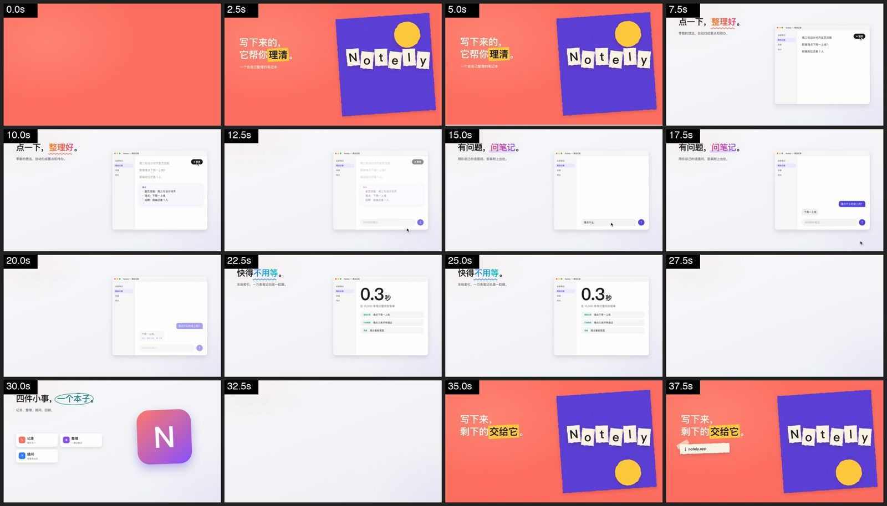

# Product Promo Video

An [Agent Skill](https://docs.claude.com/en/docs/claude-code/skills) for making 40–65 second,
Apple-keynote-style product introduction videos **entirely in code**: the picture is an HTML page
whose `render(t)` is a pure function of time, headless Chrome screenshots it frame by frame into
ffmpeg, and the soundtrack is synthesized with numpy so every cut and click lands on the beat.

[中文说明](#中文说明)



*The bundled template (a fictional notes app, "Notely"), sampled every 2.5 s.*

## Why code instead of an editor

A promo video goes through many rounds of small changes, and most rounds touch a single timestamp,
one line of copy, or one bar of music. When the whole video is code, each of those is a one-line edit
and a re-render: any frame can be reproduced on its
own, an English version is `?lang=en`, and the soundtrack follows the storyboard automatically.

## What's inside

| Path | Purpose |
|---|---|
| `SKILL.md` | The workflow the agent follows: facts → storyboard → style frames → build → sound → render & review → iterate → deliver, with a user check-in after each stage |
| `assets/template/promo.html` | A working 40 s template: intro/outro (a replaceable paper-collage example), three feature scenes (click → card, typing → streamed reply, stat stamp), recap cards |
| `scripts/render_video.mjs` | Headless Chrome via CDP → ffmpeg. Partial renders (`--from/--to`), stills, contact-sheet frames; aborts on page JS errors |
| `scripts/synth_music.py` | Additive-synthesis soundtrack + UI sound effects, driven by the page's timeline |
| `scripts/add_voice.py` | Optional narration / in-scene voice (macOS `say` or your own recordings) with ducking |
| `scripts/finalize.py` | Loudness-normalized mux, two-pass web encode, poster frame, labeled contact sheet, loudness meter |
| `references/` | Storyboard & copywriting, visual & motion vocabulary, audio arrangement rules, QA checklist |

**The intro/outro style is yours to choose.** The skill asks for your preference and mocks up 2–3
distinct directions as still frames (minimal type, product hero shot, gradient light, paper collage,
hand-drawn, UI mosaic…) before building anything. The paper collage in the template is just one
ready-to-run example; the feature scenes stay the same whichever you pick.

One design choice matters more than the rest: **the timeline lives in exactly one place**, a
`<script id="timeline" type="application/json">` block inside the page. The animation, the music,
the sound effects and the voice-over all read it, so inserting a scene means shifting bar numbers,
not hand-syncing seconds between HTML and Python.

## Requirements

- Node.js ≥ 22 (native `WebSocket`)
- ffmpeg
- Google Chrome or Chromium (set `CHROME=/path/to/chrome` if it is not found automatically)
- Python 3 with `numpy`, `scipy`, `Pillow`
- macOS `say` only if you use the built-in TTS for voice

Tested on macOS with Chrome. Linux should work but has not been verified (check that a CJK font is
installed if your copy is Chinese).

## Install

Copy or clone this folder into your agent's skills directory, for example:

```bash
git clone https://github.com/xiaoxiangtao/product-promo-video ~/.claude/skills/product-promo-video
```

Then ask the agent something like *"make a 45-second intro video for my app, Apple style"*.

## Run it by hand

```bash
mkdir promo && cd promo
cp ~/.claude/skills/product-promo-video/assets/template/promo.html .
SK=~/.claude/skills/product-promo-video

node $SK/scripts/render_video.mjs sheet promo.html out/sheet --every 2.5     # preview frames
python $SK/scripts/finalize.py sheet out/sheet out/sheet.jpg                  # contact sheet
python $SK/scripts/synth_music.py promo.html out/music.wav                    # soundtrack
node $SK/scripts/render_video.mjs video promo.html out/silent.mp4            # ~1.5× video length
python $SK/scripts/finalize.py mux out/silent.mp4 out/music.wav out/promo-v1.mp4
node $SK/scripts/render_video.mjs video promo.html out/silent-en.mp4 --query lang=en   # English version
```

Logs are written to `./log/`.

## Language note

`SKILL.md` and the reference docs are written in Chinese (the author's working language); the
scripts' CLI help and comments are mostly Chinese as well. Modern agents follow them fine
regardless of the language you talk to them in.

## License

MIT

---

## 中文说明

用纯代码做 Apple 产品介绍风格的 40–65 秒产品介绍片。画面是 HTML 页面，`render(t)` 只依赖时间；
无头 Chrome 逐帧截图后交给 ffmpeg 编码；配乐和界面音效用 numpy 合成，按同一份时间轴自动卡点。
功能段是浅色桌面上的真实产品界面复刻加光标交互演示；片头片尾的风格由你决定，技能会先出几张
不同方向的静帧让你挑，模板里的剪纸拼贴只是一个可以直接跑的示例。

安装：把本目录放进 agent 的 skills 目录，然后说"给我的 App 做一个苹果风的产品介绍视频"即可。
